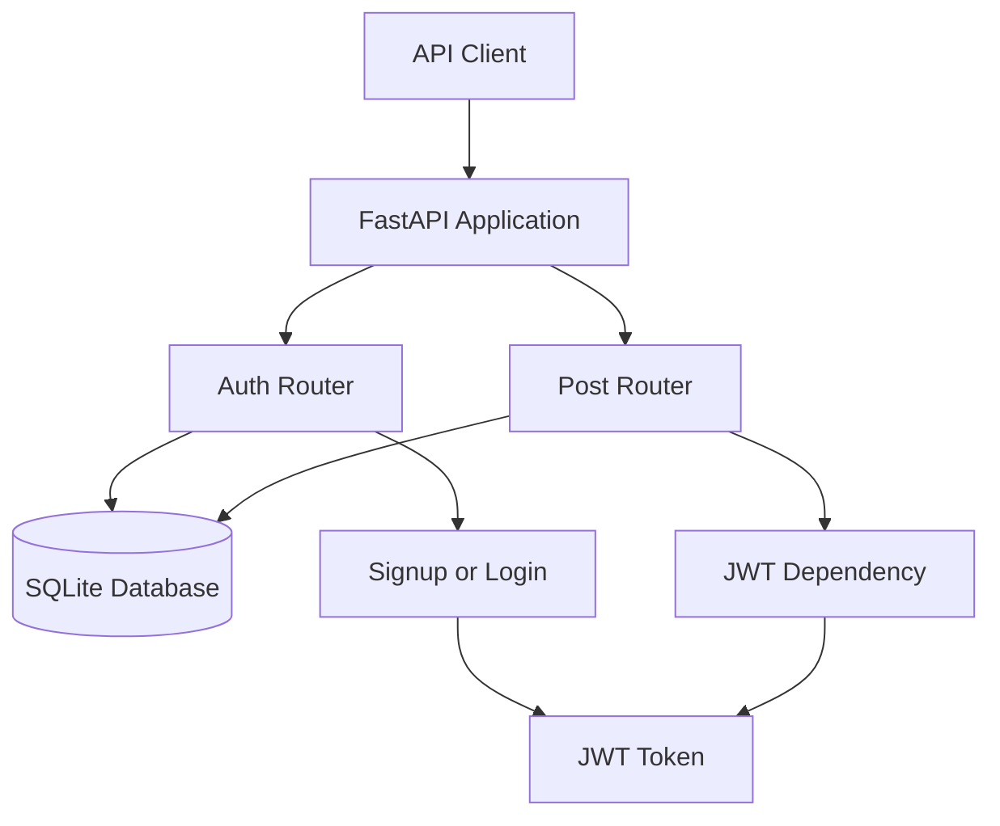
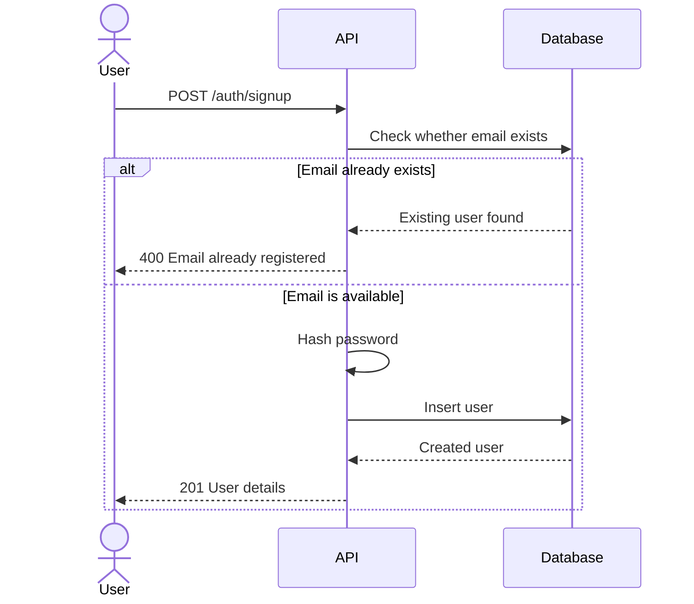
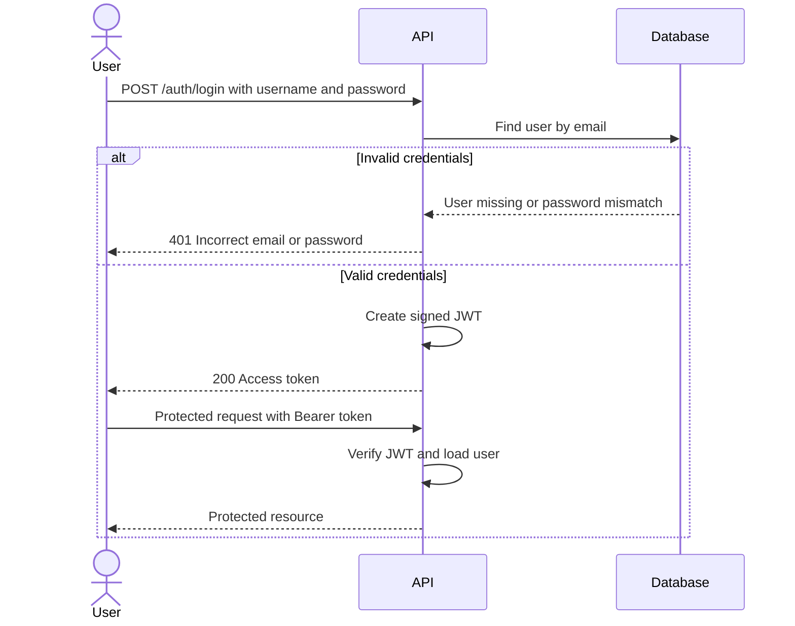
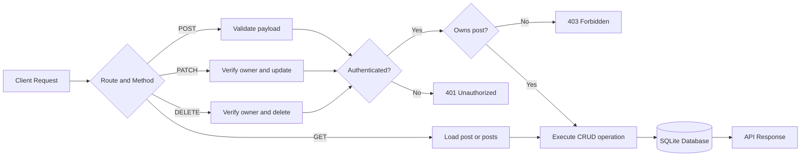

# Blog Post API

A REST API for user registration, JWT authentication, and user posts, built with FastAPI and SQLAlchemy async support.

## Tech Stack

- FastAPI
- SQLAlchemy 2 async
- SQLite with `aiosqlite`
- Pydantic v2
- Passlib with bcrypt and Argon2
- Python-JOSE for JWT authentication

## Project Structure

```text
blog_post/
├── main.py
├── config.py
├── database.py
├── dependency.py
├── models.py
├── schemas.py
├── crud.py
├── router/
│   ├── auth.py
│   └── post.py
├── requirements.txt
└── .env
```

## Setup

### 1. Create and activate a virtual environment

```bash
python3 -m venv venv
source venv/bin/activate
```

### 2. Install dependencies

```bash
python -m pip install -r requirements.txt
```

### 3. Configure environment variables

Create `.env` in the project root:

```env
SECRET_KEY=replace-with-a-long-random-secret
ALGORITHM=HS256
ACCESS_TOKEN_EXPIRE_MINUTES=30
```

Generate a secure secret with:

```bash
python -c "import secrets; print(secrets.token_urlsafe(32))"
```

### 4. Run the server

```bash
uvicorn main:app --reload
```

Open:

- API documentation: http://127.0.0.1:8000/docs
- ReDoc: http://127.0.0.1:8000/redoc

## API Routes

| Method | Endpoint | Authentication | Description |
|---|---|---:|---|
| `POST` | `/auth/signup` | No | Register a user |
| `POST` | `/auth/login` | No | Login and receive a JWT |
| `POST` | `/post/` | Yes | Create a post |
| `GET` | `/post/me` | Yes | List the current user's posts |
| `GET` | `/post/user/{user_id}` | No | List posts for a user |
| `GET` | `/post/{post_id}` | No | Get a post |
| `PATCH` | `/post/{post_id}` | Yes | Update a post owned by the current user |
| `DELETE` | `/post/{post_id}` | Yes | Delete a post owned by the current user |

## Application Flow



## Signup Flow



## Login and Authorization Flow



## Post CRUD Flow


